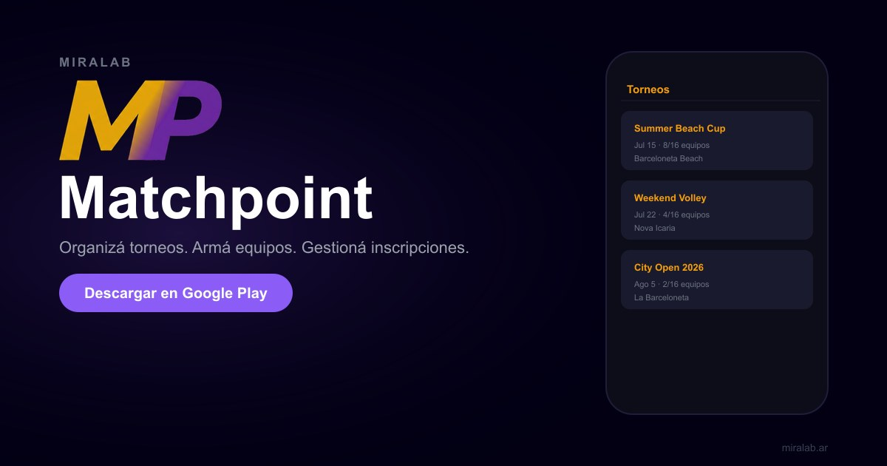
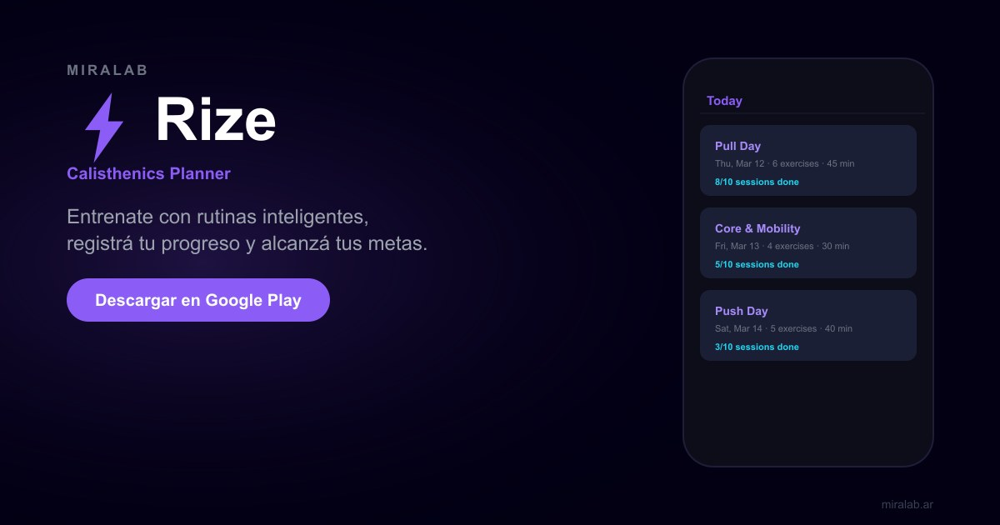
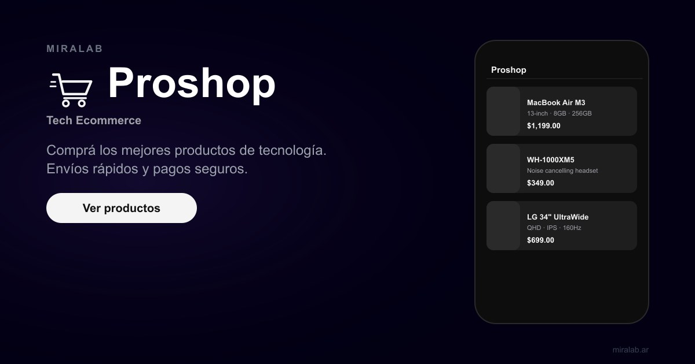

<h1 align="center">Full Stack Developer · React & TypeScript</h1>

 
 
 
 
 
 

## About

Full Stack Developer with **5+ years** of experience and a strong **frontend** focus on **React**, **TypeScript** and **Next.js**. Today I build an **AI platform for incident investigation** at **Datadope**, working across the **Next.js** frontend and the **Python / FastAPI / PostgreSQL** backend: real-time UIs over **WebSockets**, security, performance and accessibility. Before that I scaled **enterprise SPAs** with **Webpack Module Federation** and shared component libraries. I care about **TDD**, **clean code**, **WCAG accessibility** and turning **Figma** into pixel-perfect UIs, and I ship with **CI/CD**, **Playwright**, **Jest** and **Cypress** using **AI-assisted workflows**.

## Experience

**Full Stack Developer · Datadope** — May 2026 – Present · Barcelona (remote) 
Building **IOMETRICS SmartOps®**, an AI platform that helps operations teams investigate incidents with a human always in the loop. Operator console, real-time updates, password and session security, automated alert investigation and accessibility. 
Next.js · React · TypeScript · Python · FastAPI · PostgreSQL · WebSockets · Playwright

**Software Engineer · Minsait** — Feb 2024 – May 2026 · Barcelona (remote) 
Modular UI libraries and digital products for global e-commerce brands with **Webpack Module Federation**; **Next.js** dashboards for stock KPIs with **GraphQL** and REST; TDD and E2E testing with **Cypress**.

**Full Stack Developer · Urbany Hostels** — Feb 2023 – Feb 2024 · Barcelona 
SaaS products and **Stripe / PayPal** integrations to improve booking conversion; backend services and custom React hooks.

**Full Stack Developer · Worksut** — Dec 2021 – May 2022 · Barcelona (remote) 
REST APIs with **Node.js**, SQL and **MongoDB**; **React / Redux** in Scrum teams alongside UX/UI.

**Full Stack Developer · Letizia** (freelance) — Feb 2021 – Jan 2022 
Payment flows with **PayPal** and **Mercado Pago**, OTP and secure authentication.

Earlier: Head of Photography at Sodimac (2013 – 2019): e-commerce content pipelines and landing pages.

## Technologies

  
  
  
  
  
  
  
  
  
  
  
  
  
  
  
  
  

## MIRALAB — Digital studio & portfolio

*Web & mobile apps, AI-powered solutions, and full-stack delivery — built at <a target="_blank" rel="noopener noreferrer" href="https://www.miralab.ar/es">miralab.ar</a>.*

## Featured projects

  

Mobile app for **beach volleyball** tournaments — modular architecture and a clear in-game experience.

**Stack:** React · TypeScript · API integrations

<a target="_blank" rel="noopener noreferrer" href="https://github.com/octapf/matchpoint">Repository</a> · <a target="_blank" rel="noopener noreferrer" href="https://www.miralab.ar/es">Studio</a>

  

Calisthenics training app focused on **performance**, modern **UX**, and full-stack integration.

**Stack:** Next.js · TypeScript · Node.js

<a target="_blank" rel="noopener noreferrer" href="https://github.com/octapf/rize">Repository</a> · <a target="_blank" rel="noopener noreferrer" href="https://www.miralab.ar/es">Studio</a>

### Proshop

  

**E-commerce** for tech products — modern shopping UX, performance, and scalable architecture. 

**Stack:** Next.js · TypeScript · E-commerce

<a target="_blank" rel="noopener noreferrer" href="https://github.com/octapf/proshop">Repository</a> · <a target="_blank" rel="noopener noreferrer" href="https://www.miralab.ar/es">Studio</a>

  

  <em>“Debugging is like being the detective in a crime movie where you're also the murderer.”</em>

